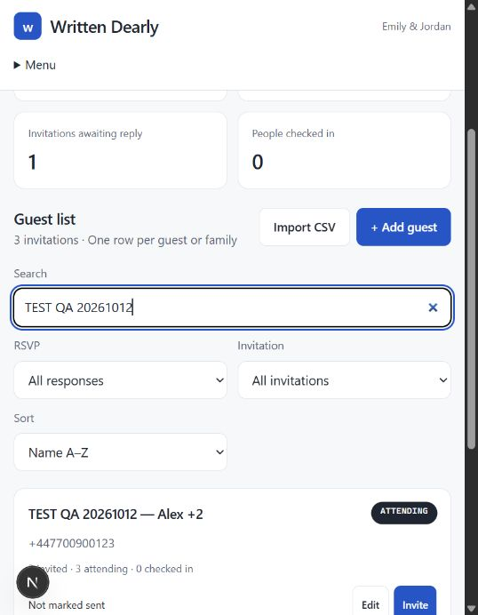

# Guest and invitation flow — live test, 12 October 2026

## How to use it

1. **Prepare the invitation.** Choose a design, enter the couple and event details, preview it and publish when ready.
2. **Add a guest.** Open Guests → Add guest. Enter a guest/family name, choose Bride or Groom, and enter the WhatsApp number with its country code.
3. **Set the allowance.** Extra guests allowed excludes the main invitee. 0 = one person total; 2 = three people total. Additional details holds email, group, table assignment and private notes.
4. **Save or prepare immediately.** Save guest returns to the list. Save & prepare invitation saves the record and opens its personalised WhatsApp message. Review the recipient, name and total allowance.
5. **Send from the published HTTPS site.** Open WhatsApp prepares the message; the couple must press Send in WhatsApp. Return and choose “I sent it — mark as sent” for manual tracking. This does not verify delivery. Localhost intentionally disables sharing because other guests cannot open a localhost link.
6. **Guest replies.** Their personal link opens the invitation with their name. They choose attending/not attending and the number coming, including themselves, up to the allowance. Submit saves the response. They can return to the same link to update it.
7. **Review replies and send the pass.** Refresh Guests to see the latest attendance. Once the guest accepts, the wedding-day QR message becomes available. Its link opens the reception pass; a QR image can also be downloaded and attached manually.
8. **At reception.** Open Check-in, search the guest or scan their QR, verify the party, and confirm arrivals. The arrival field is the cumulative total including anyone already checked in. For a party of three: enter 2 for the first two arrivals, then 3 when the last person arrives. “Still expected” means RSVP-confirmed people who have not checked in. Departures are not tracked.

## What was tested against the connected database

Two clearly labelled fictional records were created through the signed-in website. Existing guest records were not edited.

| Test | Result |
| --- | --- |
| Add Alex with a full international WhatsApp number and +2 companions | Passed; three people allocated |
| Save & prepare invitation | Passed; opened the saved guest's personalised message and unique invitation URL |
| Prevent sharing localhost URLs | Passed; Open WhatsApp, Copy message and Mark as sent disabled |
| Add Jamie with no companions | Passed; one person allocated |
| Edit Jamie: +1, email, group, notes and decline RSVP | Passed; reloaded list showed two invited and zero attending |
| Open Alex's personal invitation | Passed; correct guest name and maximum of three people |
| Submit guest RSVP for three | Passed; saved to hosted database and dashboard showed three attending |
| Change RSVP count, then restore three | Passed; final database count three |
| QR before/after accepting | Passed; unavailable before acceptance, present afterward |
| Wedding-day message | Passed; included three-person RSVP and reception-pass link |
| Search test records | Passed |
| Reception search and party details | Passed; correct three-person RSVP shown |
| Confirm partial check-in | Not completed: automatic browser approval review hit a 429 rate limit before the action executed |
| Real WhatsApp sending/delivery | Not tested; no messages sent |
| Physical camera scanning | Not tested |
| CSV import / large-list pagination | Covered by earlier isolated and fixture checks, not repeated live in this session |

## Bug found and corrected

After an RSVP save, the attendee dropdown reset to its previous default even though the database saved the selected number correctly. The count is now controlled, and automatic form reset is prevented so the visible answer stays aligned with the submitted choice. Retested through the actual personal invitation: changing from two to three retained “Me +2 (3 people total)” after success. Also corrected the singular “1 companion” helper text in the guest form.

## Cleanup and evidence

Both test guest records, including their RSVP and tokens, were removed using an exact ID/name/phone match through the database connector. No test arrivals were recorded. Existing user records were preserved. Deleted test links are no longer usable.

Screenshot of the saved test records before cleanup:

## Remaining acceptance checks

- Confirm partial arrivals, a repeat lookup/scan, final arrival and undo.
- On the public HTTPS deployment, test the WhatsApp handoff using an explicitly approved recipient, then verify the manual sent marker and undo.
- Test the camera with a real device and permission prompts.

These limits do not invalidate the successful live add/edit/RSVP/QR tests, but the full delivery-to-reception journey is not yet signed off.

