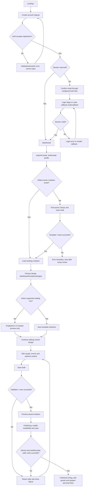
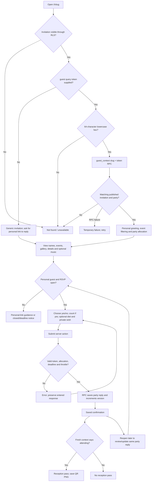
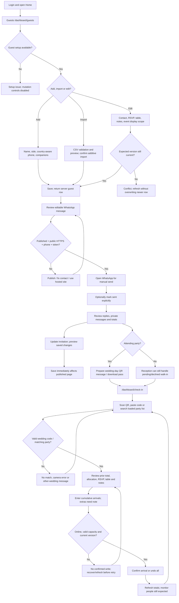

# User flows
Discovery: 15 October 2026. All journeys below require runtime verification. Diagrams describe the inspected code, not observed successful executions.

## A. New customer
Registration does not lead to a dedicated creation wizard. The first protected page calls requireInvitation, which creates a draft with the active Classic template. Design selection is then optional; Home guides toward designs when details are incomplete.

Dependencies: Supabase Auth, public.users trigger/fallback insert, active Classic row, invitations owner policies, media bucket for uploads. `src/lib/dashboard/session.ts` is called by the dashboard layout and pages; concurrent initial navigation is a bootstrap race to test. There is no exposed multiple-invitation switcher.

Conditional behavior:
- Email-confirmation setup is external. Signup returns an informational message as an error result when no session exists; do not assume the callback receives a valid code.
- A design can be previewed with `/preview/[slug]?design=coastal` without saving its selection. The Coastal catalog insert is recorded as pending, so its selectable branch is conditional.
- Editor tabs: Couple & cover, Events, Our story, Gallery, Guest information, Music, Publishing. Save does not enforce complete events or venue; only names/date are required when publishing.
- Preview opens saved data, not current unsaved edits. It disables submissions and requires ownership. Supported design override does not change data.
- On an already published invitation, Save immediately changes guest-visible content. Unchecking availability and saving returns it to a draft.
- The template compatibility gaps are listed in `FEATURE_INVENTORY.md`; a completed editor field may not be visible in Coastal.

Sources: `src/app/dashboard/actions.ts`, `src/app/dashboard/invitation/design-actions.ts`, `src/components/dashboard/home.tsx`, `src/components/dashboard/invitation-editor.tsx`, `src/app/preview/[slug]/page.tsx`.

## B. Wedding guest
The generic public URL is view-only for RSVP purposes. A guest needs the party's personal bearer token; no guest account or public guest registration exists.

Important verification points:
- A generic page reveals the invitation's event details. `event_ids` filtering depends on personal context and cannot enforce secret event information: raw published invitation theme and generic rendering remain readable. Treat access labels as display preferences unless a new security requirement is approved.
- Classic and Coastal reuse ClassicRsvp and submitRsvp; production records one party attendance total, not individual names or per-event replies.
- The SQL RPC rejects unavailable invitation, invalid/mismatched token, excess count, closed/deadline response and rapid updates within five seconds. This is the repository contract; deployed definitions are unknown.
- Confirmation is an on-page status, not an automated email/WhatsApp notification. Immediate post-submit refresh of the guest context and pass must be verified; do not assume the success banner guarantees a freshly rendered pass.
- Wishes are private to the owner dashboard. Public wall, bank card and local per-event form in the Coastal reference are not this journey.
- Declining maps to count zero. Hiding the optional message/diet fields may submit empty values and overwrite prior data; test existing replies when changing settings/status.

Sources: `src/app/i/[slug]/page.tsx`, `actions.ts`, `src/components/templates/classic-rsvp.tsx`, `reception-pass.tsx`, `classic.tsx`, `coastal.tsx`, `supabase/guest_workflow.proposal.sql`.

## C. Invitation owner
Guest setup can happen before publication; sharing is guarded by published status and public HTTPS origin.

Rules and failure paths:
- +2 companion allowance means three reserved people total; it is distinct from extra seats approved at reception.
- Import adds records and does not update matches. Repeated file submission can create duplicate parties. Delete confirms removal and invalidates that party's RSVP/pass.
- Manual sent status is independent of opening WhatsApp, RSVP and SMTP acceptance.
- RSVP and edit operations share guest version; stale owner edit after guest reply must fail. Deletion and legacy actions lack equivalent version guards.
- Check-in displays at most 40 matches; refine search to locate other parties. Guest list pages offer 25/50/100 rows while server fetches all guests in 500-row chunks.
- Scan does not mutate attendance. ConfirmArrival stores a cumulative total, not an increment; repeated scan should not duplicate people. Pending/declined parties display a warning and require operator judgment.
- Offline status allows lookup of already loaded rows; no queued writes or attendance synchronization. A save interrupted after server commit requires refresh before retry.
- Metrics: reserved seats, confirmed people, arrived people, remaining confirmed per party, and pending party count. Walk-ins must not subtract from another party's remaining arrivals.
- Reception operator is the owner session. No delegated staff provisioning or durable arrival audit log was found.

Sources: `src/components/dashboard/guests-table.tsx`, `guest-form.tsx`, `whatsapp-share.tsx`, `check-in.tsx`, `qr-scanner.tsx`, `src/lib/guests/summary.ts`, `src/app/dashboard/guest-actions.ts`.

## D. Secondary tools
- Settings → edit profile name/slug → two sequential database writes → saved/error. Name can commit when duplicate slug fails; old URLs have no redirect feature.
- Guests → table assignment → Seating groups parties by table; no drag/drop or seat capacity editor.
- RSVP wish → Messages shows private nonempty wishes newest-first; no separate moderation/publication path.
- Email studio → preview → optional test-to-owner or confirm selected sends → reserve_mail_slot → reserve delivery row → SMTP → accepted/failed/unknown. A provider accepting a message is not delivery confirmation; no webhook implementation was found. Use a sink in Session 2.
- Development fixtures → review visual states only. Coastal ReferenceRsvp intercepts submit and never persists. Some /dev/review controls reuse real server actions and can mutate the authenticated owner's real invitation; do not assume fictional props make them a sandbox.

## Model boundary
Optional named/unnamed members are an approved future model represented by `supabase/party_model.proposal.sql`, not an implemented customer journey. Keep it separate from the current aggregate interface; no live schema/model changes are part of this plan.
